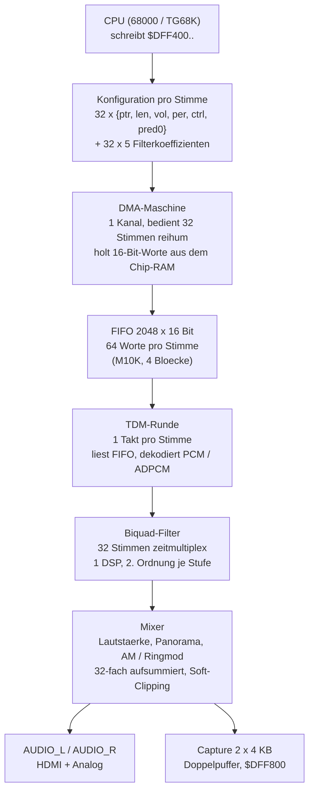
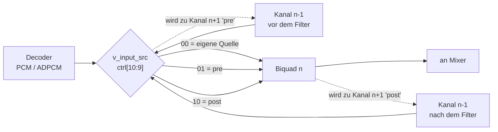

# Audio-Datenpfad: Ablauf und die vier Änderungen

Stand 2026-11-01, `main` @ `2e3ed1e`. Diese Seite zeigt, wie ein Sample vom
Chip-RAM bis zum Ausgang läuft, und an welcher Stelle die Korrekturen aus den
Pull Requests #6 und #8 sitzen.

## 1. Der Weg eines Samples



Alles bis auf die Ausgangsstufe läuft im 28,6875-MHz-Takt (`clk_28`) — das ist
wichtig für die Timing-Frage: Es gibt genau **eine** Domäne für den gesamten
Audiopfad, nicht mehrere.

## 2. Taktbudget pro Sample

| Größe | Wert |
|---|---|
| Takte pro Sample (28,6875 MHz / 48 kHz) | 596,6 |
| Stimmen | 32 |
| Takte pro Stimme (rein rechnerisch) | 18,6 |
| FSM-Zustände je Stimme im Filter | 14 |

Damit hat eine Filterbank je nach Betriebsart:

| Betrieb | Takte pro Sample | Auslastung |
|---|---:|---:|
| mono, 32 Stimmen, 1 Bank | 448 | 75 % |
| stereo, 32 Stimmen, 1 Bank | 896 | **150 %** |
| stereo, 16 Stimmen, 2 Bänke | 448 je Bank | 75 % |

Der letzte Fall ist der Grund, warum der Filter überhaupt in zwei Bänke
aufgeteilt war: Bei 32 Stimmen mit zwei Kanälen reicht eine Bank rechnerisch
nicht. Der Pending-Puffer erlaubt zwar, dass der Filter gelegentlich länger
braucht als ein Slot — aber nicht dauerhaft doppelt so lang.

## 3. Die vier Änderungen und wo sie sitzen

### #6a — Vorzeichen im Mixer-Akkumulator (Mixer-Knoten)

`mul_l`/`mul_r` sind 25 Bit breit und signed. Ein Teilbereich (`[23:8]`) ist
in Verilog **unsigned** — die Zuweisung an den signed Akkumulator
null-extendiert, aus einem negativen Produkt wird ein großer positiver Wert,
der Soft-Clipper macht Vollaussteuerung daraus.

```verilog
acc_l <= acc_l + $signed(mul_l[23:8]);   // statt  acc_l + mul_l[23:8]
```

### #6b — PCM-Loop (TDM-Knoten)

Beim Loop-Neuladen setzte `tdm_need_init` den PCM-Wert auf `{v_pred0,
v_init_idx}` zurück — bei PCM ist `pred0` null, also fügte **jeder Loop ein
Nullsample** ein. Gemessen: 500 von 65.536 Frames. Der Fix merkt sich, dass der
Reload von einem Loop kam, und überspringt das Seeding nur dann und nur bei PCM:

```verilog
wire [22:0] next_pcm_idx_val = tdm_need_init[cur_voice]
                             && !(tdm_loop_restart[cur_voice] && !v_adpcm) ? ...
```

### #8a — RAM-/DSP-Zyklen und Historie (Filter-Knoten)

Der alte FSM las Koeffizienten und Zustand im selben Takt, in dem er sie
verbrauchte. Der Fix liest einen Takt früher und registriert die
Multiplizierer-Operanden. Zusätzlich merkt sich `history_valid`, welche Stimme
eine gültige Historie hat, damit ein Reset keinen alten Zustand zurückbringt.

### #8b — Pending-Puffer und Prioritätsdurchläufe (Filter-Knoten)

Jede Stimme legt ein Sample in einen Puffer, der Filter holt sich das nächste.
Damit ist der Filter nicht mehr an den TDM-Slot gebunden. Preis: Die
Reihenfolge ist datenabhängig, deshalb die zwei festen Prioritätsdurchläufe
(32-Bit-Auswahl) und die Register-Arrays `pending_*` / `y_held_*`.

## 4. Wo die Fläche liegt

Gemessen im Fitter-Report des Filterbuilds:

| Block | ALMs | Anteil |
|---|---:|---:|
| `emu` (gesamte FPGA-Seite) | 31.537 | 81 % |
| ├ `minimig` (Amiga-Kern) | 14.731 | 38 % |
| ├ `cpu_wrapper` | 9.753 | 25 % |
| └ `audio_ext` | 7.876 | 20 % |
| &nbsp;&nbsp;&nbsp;└ `biquad_inst0` | 3.966 | 10 % |

Innerhalb von `audio_ext` sind die großen Posten keine Rechenwerke, sondern
**Register-Arrays mit variablem Index**: Jeder Lesezugriff darauf wird zu einem
32:1-Multiplexer aus LUTs. Vier davon (Volume, Periode, Control, Prädiktor)
kosten zusammen ~2.000 Flip-Flops und ebenso viele Muxe — bis sie als
Ganzwort geschrieben werden und damit im M10K landen (siehe `rudi/bram-config`).

## 5. Kanalverkettung und Filter-Bypass

`v_ctrl[10:9]` (`v_input_src`) bestimmt, woher eine Stimme ihr Eingangssample
nimmt — das ist der Pfad, der im ersten Diagramm fehlte:



Damit lassen sich Filter hintereinanderschalten (24 dB/Oktave: Stimme n filtert
mit 12 dB, Stimme n+1 setzt auf deren Ausgang eine zweite Stufe). Der
Zwei-Sample-Puffer `prev_pre_sample` / `prev_post_sample` hält dafür die Werte
der vorigen Stimme.

**Bypass:** Ist der Filter einer Stimme aus, geht das Sample unverändert durch —
`out_pcm_l = filter_en_l ? y_held_l[...] : in_pcm_l`. Es gibt keinen eigenen
Bypass-Pfad, sondern ein Mux im Filtermodul.

## 6. Zwei offene Architekturfragen

### 6.1 DMA nur im Chip-RAM, gekoppelt an Agnus

Heute hängen die Audio-DMA-Signale am Chip-DMA-Arbiter (`chipdma_arb`), also
am selben Bus wie Agnus und die Blitter-DMA. Folge: Der Audio-DMA ist auf
Chip-RAM begrenzt und konkurriert mit Agnus um Bandbreite — bei voller
Bildauslastung kann er verhungern.

Angedacht: eigener Master am SDRAM-Controller über den vollen Adressraum,
unabhängig von Agnus. Das ist ein Eingriff in die Speicherarbitrierung, nicht
eine lokale Änderung.

### 6.2 Zwei Filter-DSPs nach Seite statt nach Stimmenhälfte

Heute sind die zwei Biquad-Instanzen über `cur_voice[4]` geteilt: Instanz 0
filtert Stimmen 0–15, Instanz 1 Stimmen 16–31. Jede Instanz rechnet beide
Seiten nacheinander, also 2 × 14 Zustände pro Stimme.

Sinnvoller wäre die Teilung **nach Seite**: eine Instanz für links, eine für
rechts, beide über alle 32 Stimmen. Dann fallen für eine Stimme 14 statt 28
Zustände an:

| Aufteilung | Takte pro Sample | Auslastung |
|---|---:|---:|
| 2 Bänke nach Stimmen (heute), stereo | 448 je Bank | 75 % |
| 1 Bank für 32, stereo | 896 | 150 % (passt nicht) |
| **2 DSPs nach Seite, 32 Stimmen** | **448** | **75 %** |

Die dritte Zeile ist der Punkt: Die Teilung nach Seite löst dasselbe Problem
wie die heutige Aufteilung, aber ohne die Stimmenzahl zu halbieren.